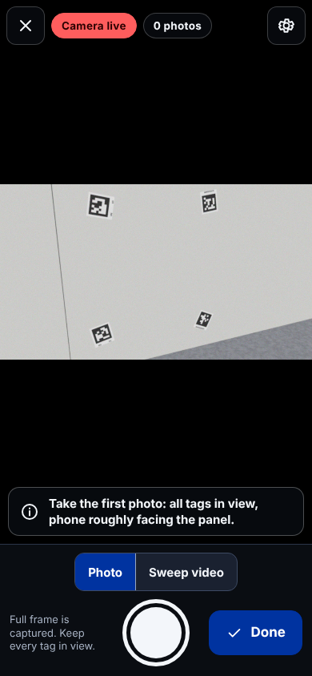
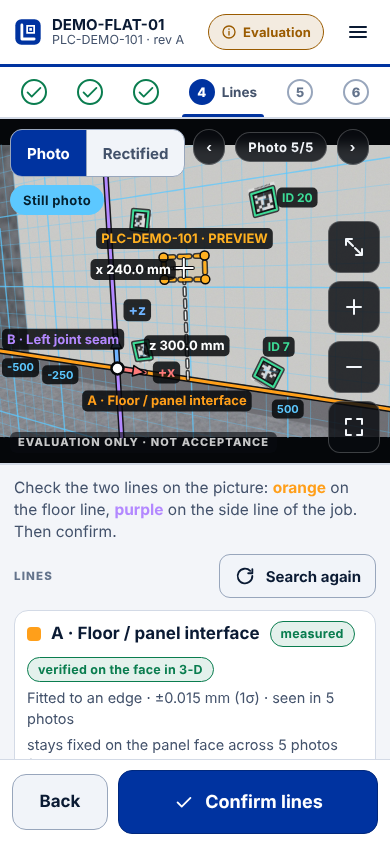
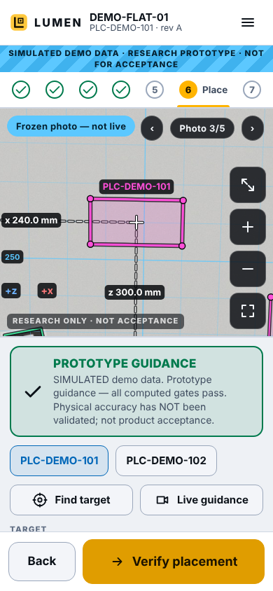
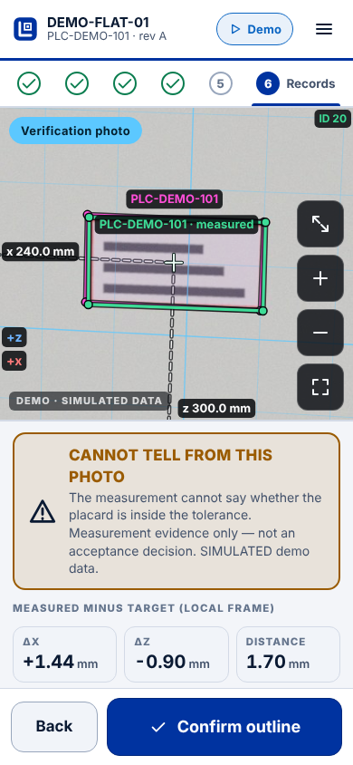
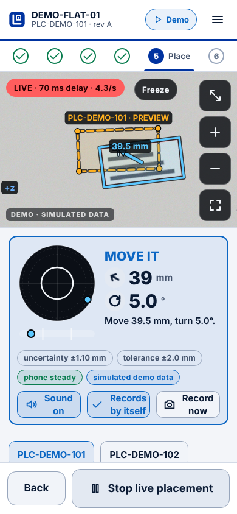
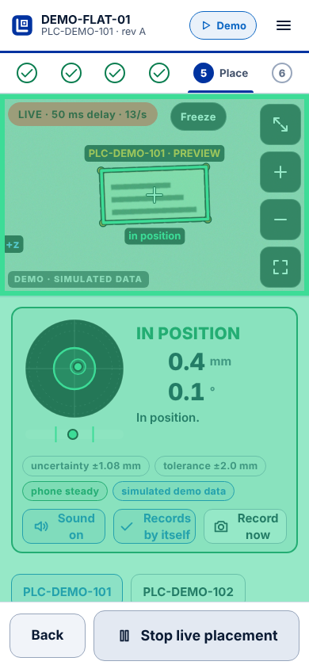
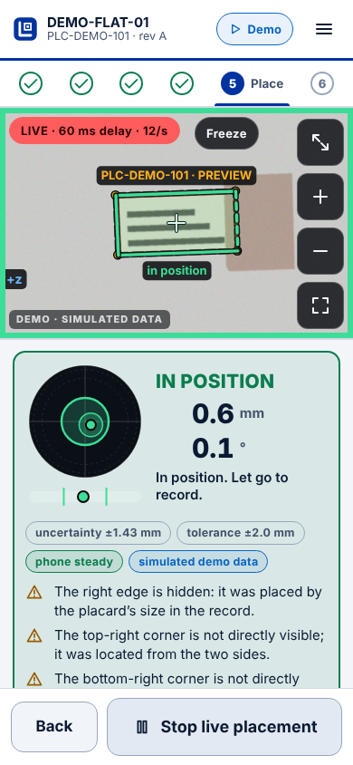
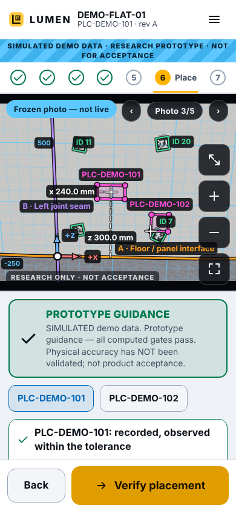

# LUMEN

Browser-based optical measurement and placard positioning. A phone's rear
camera, a few commercially available AprilTag stickers of measured size, and
two datum features on the panel are enough to show where a placard goes, to
measure it while it is being put there, and to record where it ended up. No
CAD model, no native app, no LiDAR, no NFC, no extra optical hardware.

> **Research prototype.** Everything LUMEN shows is measurement evidence, not
> product acceptance. All accuracy figures in this repository come from
> computer-generated photos. Nothing has been measured with a real phone, a
> real print or a real panel, and nothing has been deployed to a Posit Connect
> server: those steps are written down and marked NOT RUN
> (`docs/PHYSICAL_TEST_PROTOCOL.md`, `docs/POSIT_CONNECT.md`).

## What it does

| Step | What happens |
|---|---|
| Identify | choose the operation and placard, or scan a bar code / QR code (exact matches only); records can be entered and revised in the app |
| Markers | enter the caliper-measured edge of each tag's black square; scale comes from nothing else |
| Capture | photos, or a video from which sharp, well-spread frames are selected; coaching on distance, angle, glare, coverage |
| Datums | floor line and side line are found and fitted to sub-pixel edges; a rounded side edge is modelled from its outline in several photos; the operator confirms |
| Rectified | metric straight-on view with a grid from the datums; optional rule measurement that catches a wrong tag size |
| Place | the target outline on the photo with distances, uncertainty and a status that says what was and was not checked. **Live placement**: the camera watches while the placard is positioned; every frame says how far it is from its target and which way to move it, on the screen and by sound; it turns green in position and the placement is recorded by itself |
| Verify | the record of the placement, or a new photo of an installed placard: the outline is measured and compared with the target, signed deviations with uncertainty; export; delete |

How it stays honest:

* the frame of reference is built only from the datums and signs the record
  defines; gravity, the phone's sensors and "up in the picture" are not used;
* tags are placed anywhere on the flat face; their layout is solved, cross-checked
  between tags and, with several photos, checked for coplanarity in 3-D;
* missing or contradictory geometry gives "no guidance" with a reason and a
  next step, never a guess; no datum, offset or tolerance is invented;
* every result carries an uncertainty budget and the list of checks behind its
  status; simulated data is labelled on every screen;
* what was not checked is said as well: a check that passes on someone's word
  (scale from the entered tag sizes only, a datum on the face by the record's
  statement, a tag that was set aside) is shown as a note, not as a tick;
* where the photos cannot decide, the operator is asked: two similar seams,
  or a raised edge running along the line that was found (the top of a kick
  strip looks like a floor line);
* "in position" in a live frame is the rule of the verification (deviation
  plus uncertainty inside the record's tolerance) and records nothing; a
  placard held off the surface, or covered so far that this cannot be told,
  is not judged; the record is a stored photo in which all four sides are
  measured;
* a flashlight (photometric) analysis of rounded edges and an optional
  language-model assistant exist as clearly separated experiments that never
  feed the guidance.

## Screens

   

Live placement: on the way, in position, and with a hand over one side (the
covered side is drawn dashed):

   

Screenshots from the automated browser tests (phone-sized window,
computer-generated photos). More in `docs/OPERATOR_QUICKSTART.md`.

## Results so far (computer-generated photos only)

`scripts/run_benchmark.py` on layouts the tests never use: two sets of twelve,
three to five tags, three to seven photos of 1600x1200, four kinds of
in-camera processing. Reports: `docs/benchmark/`.

| 24 layouts | one photo, datums drawn by hand | all photos, datums found automatically |
|---|---|---|
| error of the target corners, median / 95th / largest | 0.17 / 0.51 / 0.89 mm | 0.12 / 0.46 / 0.61 mm |
| stated expanded uncertainty, median / largest | 1.24 / 3.06 mm | 1.07 / 2.07 mm |
| error within the stated uncertainty | 24 of 24 | 24 of 24 |
| shown as guidance / as preview | 6 / 18 | 8 / 16 |
| wrong result shown as guidance | 0 | 0 |
| analysis time, median (four shared cores) | 1.2 s | 16 s |

Most results are previews at this photo size because the stated uncertainty
exceeds half of the sample record's ±2 mm tolerance. In 40 of the 48 results
its largest term stands for something these photos do not contain (a bound
on residual edge shift or on panel flatness, or the caliper uncertainty of
the tag sizes), which is why the errors are several times smaller than the
stated values. That margin says nothing about a real phone.

At a phone's full photo resolution (4032x3024, four of the layouts) the
errors are 0.03 mm (median) and 0.14 mm (largest) from one photo and 0.02 and
0.12 mm from all photos. The stated uncertainty is about 0.7 mm, all eight
results are within it, and six are shown as guidance. One photo with datums
drawn by hand takes about 4 s; finding the datums automatically in five to
seven such photos takes about a minute and a half.

Seventeen fault cases (no tag; a moved, a raised and a mis-sized tag; no
measured sizes; twin seams; a kick strip that hides the floor line; a leaning
edge; a faint seam; glare; a duplicate ID; a curved target; a draft record
…) end in a refusal, in a preview that names the reason, or in a correct
result without the faulty tag. One fault cannot be seen in photos at all:
every tag size wrong in the same way gives 17.9 mm of error with a clean
report. The optional rule measurement catches it, and every result without
one says that its scale rests on the entered sizes alone.

Two findings on the way to these numbers (`docs/BUILD_LOG.md`):

* The first full run counted all fault cases as handled. Four of them ended
  safely and were not right inside; they were fixed after reading the reasons
  instead of the verdicts.
* The first run at full resolution had every target 1.0 mm off and outside
  its stated uncertainty. The 2 mm side seam is resolved into its two edges
  at that size, and one of them had been taken for the datum. A seam is now
  measured at its centre at any photo size.

### Live placement

Tests against the renderer's truth (`docs/VALIDATION.md`, section 6), live
frames of 1280×720 from 640 mm, target tolerance ±2 mm and ±1°:

| | |
|---|---|
| deviation of a placard at known places on its way to the target | within 0.12 mm and 0.08° |
| stated uncertainty of a live reading (lens profile for the registration photos) | ±1.07 mm; ±1.4 mm while a hand covers a whole side |
| the same without a lens profile | ±1.84 mm: only ±0.16 mm of the tolerance is left, and the screen says so |
| a hand over a corner, a side, the lower half, the middle of both ends | position within 0.3 mm; never recorded while covered |
| both ends gripped completely; a part of another size; a placard held 8 mm off the surface | no judgement, with the reason |
| server time per frame, phone on a stand: placard followed / no placard in view / first frame | 0.04 s / 0.14 s / 0.9 s |
| the same while the phone is moved (the tags are measured in every frame) | 0.17 s / 0.27 s / 0.9 s |
| results per second in a browser on the same machine, phone on a stand | 12 (the page asks for no more), each shown about 40 ms after its picture was taken |
| from "in position, hands off" to the chime of the record | about 2 s (one second of rest, then 0.7 s for the photo and its measurement) |

While the phone stands still the tags are measured once and then only
checked: every frame is asked whether the picture around each tag is still in
the same place (to a few hundredths of a pixel). That is what makes a frame
cost 0.04 s, and it keeps the registration when an arm covers some of the
tags.

Hands are skin-coloured boxes in rendered pictures here, and the tones were
checked as commands in a browser without a loudspeaker.

Tests on this code: 534 unit and integration tests and 42 browser tests pass;
one test that calls a real language-model endpoint is opt-in and skipped.

None of this is physical accuracy: no phone, print or panel was involved.

## Run it

Python 3.12 or 3.13 (the pinned NumPy does not install on older versions).

```bash
python3 -m venv .venv
```

```bash
.venv/bin/python -m pip install -r requirements.txt
```

```bash
.venv/bin/python -m uvicorn app:app --host 127.0.0.1 --port 8000
```

Open <http://127.0.0.1:8000/> and choose **Load demo session** to walk
through all seven steps on simulated photos. To use a phone's camera the page
must be served over HTTPS; deploying to Posit Connect provides that
(`docs/POSIT_CONNECT.md`).

LUMEN keeps a session with the process that serves it, and live placement
asks that process several times a second. It needs a host on which one
process keeps running. It does not work on function platforms (Vercel, AWS
Lambda and the like), where each request may meet a new, empty instance; on
such a host the first screen says so (`docs/POSIT_CONNECT.md`, section 5).

Tests, benchmark and smoke test:

```bash
.venv/bin/python -m pip install -r requirements-dev.txt
```

```bash
.venv/bin/python -m pytest
```

```bash
.venv/bin/python scripts/run_benchmark.py
```

```bash
.venv/bin/python scripts/smoke_test.py http://127.0.0.1:8000/
```

## Documents

| Document | For |
|---|---|
| `docs/OPERATOR_QUICKSTART.md` | using the app, step by step |
| `docs/TROUBLESHOOTING.md` | messages and what to do about them |
| `docs/POSIT_CONNECT.md` | publishing on Posit Connect, settings, storage, smoke tests |
| `docs/DEVELOPER_HANDOFF.md` | architecture diagram, module map, rules, what is not done |
| `docs/CONVENTIONS.md` | units, pixels, frames, labels, status words |
| `docs/VALIDATION.md` | what was tested, how, and what the results do and do not show |
| `docs/benchmark/` | synthetic benchmark reports (generated): first set with fault cases, second set, full resolution |
| `docs/PHOTOMETRIC_ABLATION.md` | flashlight experiment against the edge-only method |
| `docs/PHYSICAL_TEST_PROTOCOL.md` | the physical study that still has to be run |
| `docs/ASSISTANT.md` | the optional assistant: what is sent, how replies are checked |
| `docs/BUILD_LOG.md` | what was built, measured results, and what did not work |
| `prompt_series/` | the requirements this implementation follows |

## Data in this repository

Only generic, invented content: synthetic panel images, a sample operation
library marked as synthetic, no real parts, dimensions, photos, credentials
or internal services. Use an approved environment for real manufacturing
data, and validate physical accuracy, surface compatibility and tooling
controls before any production use.

## Original brief

The three sections that follow are the brief this repository started from, kept word for word. What was actually built, measured and left undone is described above and in `docs/`.

## Build with Fable 5.2
Read every file in `prompt_series/` before coding. Execute in numeric order, starting with 00_MASTER.md. Maintain a working app at each milestone. Improve the proposed algorithms and UX when evidence supports it; document decisions and test results. Do not stop at design documents or pretend unimplemented features work.

Target: single-origin FastAPI web application deployed to Posit Connect, CPU-first Python/OpenCV/NumPy/SciPy and locally bundled JavaScript/HTML/CSS. Verify target platform dependencies and browser behavior. Use synthetic fixtures and generic configurations only; no employer data, photos, credentials or internal requirements in this repository.

## Workflow
Identify operation, place 2–4 distinct known-size AprilTags near the target, capture overlapping images or video of the side boundary/curvature and floor interface, establish scale and local geometry, confirm datums, calculate specified target corners, show registered placement guidance, then measure observed placement from a verification image. Photometric analysis is a research extension to reliable planar metrology. Require explicit coordinate definitions and fail closed on ambiguous or unvalidated geometry. All outputs are prototype guidance, not product acceptance.

## Reference links
- https://docs.posit.co/connect/user/fastapi/
- https://developer.mozilla.org/en-US/docs/Web/API/MediaDevices/getUserMedia
- https://developer.mozilla.org/en-US/docs/Web/API/MediaStreamTrack/getCapabilities
- https://docs.opencv.org/4.x/d9/dab/tutorial_homography.html
- https://github.com/AprilRobotics/apriltag
- https://texxary-shop.com/products/april-tags-sticker-sheet
- https://arxiv.org/abs/2303.14190 (research background)

Use only approved environments for real manufacturing data and validate actual physical accuracy, surface compatibility and tooling controls before production use.
