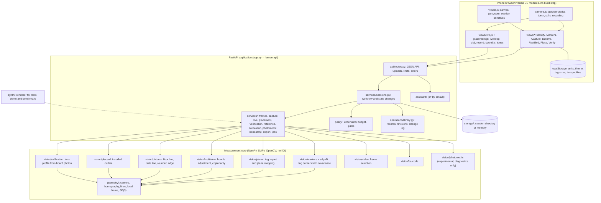

# Developer handoff

What LUMEN is, how it is put together, how to run and change it, and what is
not done. Read `docs/CONVENTIONS.md` first; `docs/BUILD_LOG.md` has the
measured results and the things that did not work, in the order they
happened.

## 1. Run it

```bash
python3.12 -m venv .venv
```

```bash
.venv/bin/python -m pip install -r requirements-dev.txt
```

```bash
.venv/bin/python -m uvicorn app:app --host 127.0.0.1 --port 8000
```

Open <http://127.0.0.1:8000/>. On `localhost` a browser allows the camera
without HTTPS; from a phone the page has to be served over HTTPS (Posit
Connect does that, see `docs/POSIT_CONNECT.md`).

Tests:

```bash
.venv/bin/python -m pytest tests/unit tests/integration
```

```bash
.venv/bin/python -m pytest tests/browser --trace off
```

The browser tests need a Chromium for Playwright (`CHROMIUM` in
`tests/browser/conftest.py`) and are skipped without one. Rendered test
photos are cached in `.pytest_cache/lumen_renders`; the first run is slow.

Benchmark and its report (`docs/benchmark/RESULTS.md`):

```bash
.venv/bin/python scripts/run_benchmark.py
```

Smoke test of a running instance (local or deployed):

```bash
.venv/bin/python scripts/smoke_test.py http://127.0.0.1:8000/
```

## 2. Architecture

One FastAPI process serves the web interface and the API from the same
origin. There is no database, no message broker, no GPU and no build step
for the front end.



Data flow of a measurement:

1. A photo is decoded upright, reduced if very large, and its tags are
   measured: each border is a fitted edge, each corner the intersection of two
   edges with a covariance, corrected for the dark-side edge shift estimated
   from the tag's own interior (`markers.py`, `edgefit.py`).
2. `planar.py` solves the layout of the tags on one plane and a mapping per
   photo (homography, or pose with a lens profile), with cross-checks between
   tags. With several photos `multiview.py` runs a bundle adjustment and tests
   coplanarity and the lens profile in 3-D.
3. `datums.py` finds the floor line and the side line (or a rounded edge from
   its silhouettes in several photos); the operator confirms them.
   `geometry/localframe.py` builds the local frame from the two lines and the
   record's signs and axis rule.
4. `policy/uncertainty.py` propagates pixel noise by Monte Carlo through the
   whole chain and adds systematic bounds; `policy/gates.py` turns the facts
   into a status with reasons.
5. `overlay/geometry.py` projects the target into the photo as drawing
   primitives; the browser only draws them. The browser never computes
   geometry.
6. Live placement (`services/live.py`, `services/placement.py`): the browser
   sends reduced camera frames one after another. Each is registered against
   the tag layout, the placard is measured in it (`vision/placard.py`, the
   same outline measurement as a verification, with the allowances of
   `docs/CONVENTIONS.md`, "A placard in a live frame"), and the answer says
   how far the placard is from its target and whether it is in position.
   Two things carried from frame to frame make that fast, and the client
   hands both back with the next frame: the stream's edge shift (so the tags
   are measured without re-estimating it) and where the placard was (so it is
   followed instead of searched for). Nothing of this is stored. When the
   placard has been in position and uncovered for a second, the browser
   uploads one full-size frame as a verification photo and the ordinary
   verification is the record.

State: a session is one JSON document plus photo blobs behind
`storage.SessionStore` (file directory with a lock, or memory). Every change
goes through `SessionService._mutate`, which loads, changes and saves under
the session lock; background video jobs write their progress into the session
too, so any worker process can answer a poll. Changing tag sizes, photos or
the lens profile invalidates everything computed from them.

## 3. Where things are

| Path | Contents |
|---|---|
| `app.py` | entry point `app:app` |
| `lumen/api/` | application factory (security headers, base-path handling), routes |
| `lumen/services/` | workflow: sessions, frames, capture coaching, live guidance and live placement, verification, scale check, calibration workspaces, the research-only flashlight step, export, jobs |
| `lumen/vision/` | measurement algorithms (see the diagram) |
| `lumen/geometry/` | camera model, homographies, lines, local frame, rigid transforms, a small Levenberg–Marquardt solver |
| `lumen/policy/` | uncertainty budget and gates, with their thresholds in one dataclass each |
| `lumen/operations/` | record schema, library with revisions, the bundled synthetic sample |
| `lumen/overlay/` | drawing primitives in image pixels |
| `lumen/storage/` | session stores |
| `lumen/synth/` | deterministic ray caster, scenes, calibration boards (tests, demo, benchmark only) |
| `lumen/validation/` | benchmark cases and report |
| `lumen/assistant/` | optional language-model explanations, off by default (`docs/ASSISTANT.md`) |
| `lumen/static/` | the web interface |
| `lumen/demo_assets/` | pre-rendered photos of the demo session |
| `tests/unit`, `tests/integration`, `tests/browser` | algorithm tests against ground truth; API flows; Playwright walkthroughs on a phone-sized viewport |
| `scripts/` | benchmark, smoke test, manifest, demo asset generation, photometric ablation |

## 4. Rules the code keeps (and tests check)

* **Fail closed.** Missing or contradictory geometry gives `blocked` with a
  reason and a suggestion, never a guess. A low reprojection error alone
  passes nothing.
* **Nothing invented.** No tolerance, datum, sign or size is defaulted. A
  missing field in a record is an issue, not a zero.
* **Scale only from declared tag sizes.** Never from a bar code, the sticker
  outline or EXIF.
* **No gravity.** Directions come from the datums and the record.
* **The picture and its overlay belong together.** An outline is drawn only
  on the frame it was computed for; live guidance shows the analysed frame.
* **A reading that is no longer current is withdrawn.** When no answer
  arrives, the overlay, the dial and the tone stop (`STALE_MS` in `live.js`
  and `sound.js`).
* **Green is guidance, the record is a photo.** "In position" in a live frame
  uses the rule of a verification (deviation plus expanded uncertainty inside
  the tolerance) but allows for hands; it stores nothing. The record is a
  stored full-size photo with all four sides measured, and it is announced as
  recorded only if that measurement is inside the tolerance too.
* **A session lives with one process (or one shared directory).** On a host
  that starts an empty instance per request the application says so
  (`Settings.hosting`) instead of failing step by step.
* **Labels.** Simulated data says so on every screen; manual, inferred and
  measured values are distinguished in the data and the interface.
* **No raw HTML from data.** The front end builds the page with
  `createElement`/`textContent` (`dom.js`); the content security policy lets
  scripts run only from the app's own files plus one bootstrap script with a
  per-response nonce, and has no `eval`.
* **No absolute addresses.** Every address is relative so the app works under
  any path prefix (tests run it behind a path-stripping proxy).

## 5. Changing things

*A new check (gate):* add the fact to `GateInputs`, fill it in
`SessionService._gate_report`, add the gate in `evaluate_gates` with a message
and a suggestion, and a test in `tests/unit/test_gates.py` for both outcomes.
Blocking gates remove the outline; warning gates make it a preview. A fact
that was not checked but does not lower the status is an `info` gate with
`caveat=True` (it keeps its suggestion and is shown with an "i").

*A threshold:* gate thresholds are `GatePolicy`, budget bounds are
`UncertaintyConfig`, detector limits are `MarkerConfig`. The gate thresholds
can be overridden per deployment (`LUMEN_POLICY_FILE`). The defaults are
placeholders chosen on synthetic data; they are not engineering limits.

*Anything that can change a number:* bump `ALGORITHM_VERSION` in
`lumen/__init__.py`, re-run the benchmark, and record the change in
`docs/BUILD_LOG.md`. Sessions and exports carry the version.

*A storage backend:* implement `lumen.storage.base.SessionStore` and return it
from `get_store()`.

*A new screen:* a module in `lumen/static/js/views/` exporting
`mount(root, ctx)`, registered in `main.js` and `store.js` (`STEPS`,
`stepAvailability`). Build elements with `h()` from `dom.js`.

## 6. State of the work

Implemented and tested on synthetic data (see `docs/BUILD_LOG.md` and
`docs/benchmark/RESULTS.md` for numbers):

* photos, video frame selection, camera and torch control in the browser;
* tag measurement, planar registration, multi-view bundle adjustment;
* automatic and manual datums, rounded-edge silhouette model;
* uncertainty budget and gates; independent scale check;
* target overlay on stills, rectified view, live guidance;
* live placement: the placard measured in every live frame while it is
  positioned, with hands on it, direction and distance on the screen and by
  sound, and the record taken by itself;
* verification of an installed placard; export; deletion;
* operation library with manual entry, revisions and code scanning;
* lens profiles from board photos;
* Posit Connect packaging and a deployment guide.

Experimental (diagnostics only, never guidance):

* photometric analysis of a rounded edge under the phone torch
  (`docs/PHOTOMETRIC_ABLATION.md`);
* the optional assistant.

Not done, or not possible here:

| Item | Status |
|---|---|
| Any measurement on a real phone, real print or real panel | NOT RUN (`docs/PHYSICAL_TEST_PROTOCOL.md`) |
| Deployment on a Posit Connect server | NOT RUN (`docs/POSIT_CONNECT.md`, section 9) |
| iPhone Safari camera, torch and recording behaviour | NOT RUN; the code follows the published browser interfaces and was exercised in Chromium with a fake camera only |
| Live placement with a real hand, a real placard and a real phone; sound on a phone | NOT RUN. Hands were boxes in rendered pictures; the tones were checked as commands in a browser without a loudspeaker |
| Frame-rate tracking in the browser between server answers | not built; the picture and the reading update as fast as the server answers (about five times a second on the development machine, less over a network) |
| Validated domain | none; the status `validated` cannot occur |
| Curved target surfaces | refused by design |
| Rolling shutter, focus breathing, optical stabilisation, local tone mapping | not modelled in the synthetic photos; covered only by generic bounds in the budget |
| Text recognition (OCR) of printed identifiers | not implemented |
| Approval workflow for operation records | none: anyone who can open the app can release a record; the change log shows who did |
| Database or object-store session storage | adapter interface only |

## 7. Known weak points

* Every live frame makes a round trip to the server. With the stream's edge
  shift and the placard's last place handed back by the client, a 1280×720
  frame costs about 0.17 s of server time on the development machine (0.9 s
  for the first frame, 0.3 s while no placard is in view, 0.4 to 0.7 s when a
  covered placard has to be searched for again). On a network the rate is
  lower. The picture shown is always the analysed one, so the display moves
  in steps.
* What tells a hand from a placard in a live frame is colour and brightness
  beside the edges (`foreign_sides`, `plain_fraction` in `vision/placard.py`)
  and the record's size. The thresholds were set on rendered pictures in
  which a hand is a skin-coloured box, with and without the chroma
  subsampling of a video stream. A glove or a tool of the panel's colour is
  not told apart by colour; the size checks are then the only guard, and they
  need two opposite sides. A reading with hands on the placard is never
  recorded, but it is shown and sounded.
* A live reading is checked for "lying on the surface" by its size only, and
  the height that this cannot exclude is carried as an uncertainty that
  grows with the viewing angle. A phone that looks at the panel obliquely
  will therefore rarely show "in position" for a tight tolerance.
* Without a lens profile for the registration photos the budget carries an
  allowance for an uncharacterised lens that acts mostly through the datum
  lines (1.4 mm in the test layout). Against a ±2 mm tolerance that leaves
  0.2 mm of room for "in position". The live picture's own lens matters
  little (0.16 mm in the same layout), because the placard sits among the
  tags.
* The stated uncertainty is dominated by generic bounds (residual edge shift,
  panel flatness, lens model). On synthetic photos the true error is several
  times smaller than the stated value; whether the bounds are right for a real
  phone is exactly what the physical protocol has to establish.
* Small tags (under about 52 px edge) cannot have their own edge shift
  estimated. They take the value measured on larger tags of the same photo
  or session and carry a larger bound; when no tag is large enough the bound
  is larger still. Photos at full phone resolution avoid this, reduced live
  frames often do not.
* Whether a horizontal datum line lies on the panel face cannot be verified
  from photos taken at one height; it is then taken as the record declares
  it. The same holds for a vertical line and photos from one side.
* The synthetic photos used by the unit and integration tests are rendered
  with a regular sub-pixel grid that displaces edges at some slopes by up to
  about 0.1 px; the benchmark uses a sampling pattern without that fault
  (`pattern="lattice"`).
* A common error in all declared tag sizes is invisible without the scale
  check, which is optional. The list of checks says so on every result that
  has no rule measurement (`scale_source`).
* Which feature a record means by "the floor line" is not something the
  photos contain. LUMEN asks when a raised or recessed edge runs along the
  line it found (`step_beside` in `vision/datums.py`); the distances that
  trigger the question (30 mm, a depth under half the distance, 250 mm) were
  chosen on one synthetic kick strip and its absence on 24 layouts without
  one. A trim whose other edges are not found in any photo is not noticed.
* The benchmark's verdict column says whether an outcome was safe. Four
  faults were once hidden behind it (`docs/BUILD_LOG.md`, "First full
  benchmark: four faults behind 'handled'"): read the reasons, not only the
  verdicts.
* A seam is one feature up to 6 mm of width (`max_line_width_mm`) and is
  measured at its centre. The model for a seam that a photo resolves (two
  opposite edges, the same level outside both) was added after the first
  full-resolution benchmark put every target half a seam's width off; it has
  seen one seam width in rendered photos (2 mm at 3.4 px/mm) and other widths
  only as synthetic profiles in unit tests. Seams with a bright line in them,
  chamfered joints and gaps with something visible inside are untested.
* Finding the datums automatically on five to seven full-resolution photos
  took 74 to 103 s on four shared cores (the search re-finds every candidate
  line in every photo at full size). One such photo with lines drawn by hand
  takes about four seconds; at 1600x1200 the two figures are 11 s and 1 s.
* The line finder works on segments that a general detector merges. A long
  segment that runs over two features is now measured part by part, but only
  in three fixed parts (middle half, either half); a feature that is the
  smaller part of a segment split elsewhere can still be missed, and then has
  to be drawn by hand.
