# Operator quick start

LUMEN shows where a placard goes on a panel, from photos taken with a phone,
and afterwards measures where it actually is. It is a **research prototype**:
what it shows is measurement evidence, not an acceptance decision. Nothing in
it has been validated on real hardware (`docs/PHYSICAL_TEST_PROTOCOL.md`).

## What you need

* A phone with a rear camera and a current browser. Open the address your
  administrator gave you; it must start with `https://`.
* Two to six AprilTag stickers (family 36h11, about 50 mm), each with a
  different ID.
* A caliper to measure the black square of each sticker. A steel rule for the
  optional scale check.
* Good, even light. No glare on the stickers.

## Try it without a panel

On the first screen choose **Load demo session** (a flat panel with a seam) or
**Demo with a rounded edge**. Each loads computer-generated photos of an
invented panel and runs the real measurement on them. Every screen says
"simulated" while a demo is open.

## The seven steps

The row of numbered steps at the top shows where you are. A step opens when
the ones before it have what it needs. The pictures below are screenshots of
the automated browser tests on a phone-sized window; everything in them is
computer-generated.

### 1. Identify

Pick the operation and the placard, or press **Scan** and point the camera at
the bar code or QR code of the work order, panel or placard. LUMEN selects a
record only when the code matches exactly one. Read the datum descriptions on
this screen: they tell you which line is the floor datum and which is the side
datum. If the record is marked *incomplete* or *draft* you can look at a
preview but not get guidance.

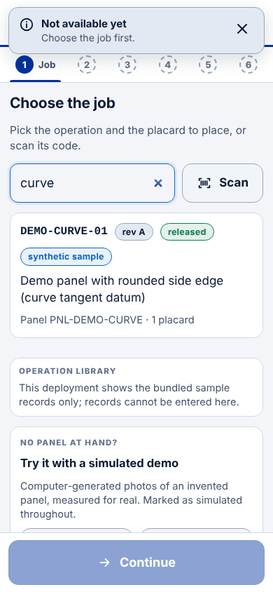

### 2. Markers

Stick the tags flat on the flat face of the panel:

* around the place where the placard goes, not all on one side of it;
* not on trim, not on the floor, not on a curved part, not over a seam;
* each one fully visible, flat, without bubbles.

Measure the **black square** of each tag with the caliper (the picture on the
screen shows which edge) and enter the value next to its ID. Do not enter the
size of the sticker or the number on the packaging. Tags without a measured
size keep the result at "research preview".

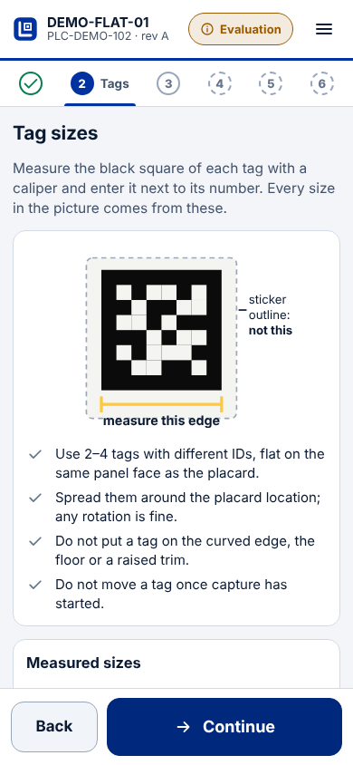

### 3. Capture

Press **Open camera**. Hold the phone 50 to 90 cm from the panel.

* One photo is enough for a flat panel when all tags, the floor line and the
  side seam are in it.
* Three to nine photos from different sides (move about a step between them)
  let LUMEN check that the tags are on one plane and are required for a
  rounded side edge. **Sweep video** does the same: record up to 30 s while
  moving slowly around the panel; LUMEN picks sharp frames from it.
* The coach line under the camera picture says what is missing: closer,
  further left, hold still, glare.

Then press **Analyse**. Do not touch the tags between photos. If a tag was
moved, start the capture again.

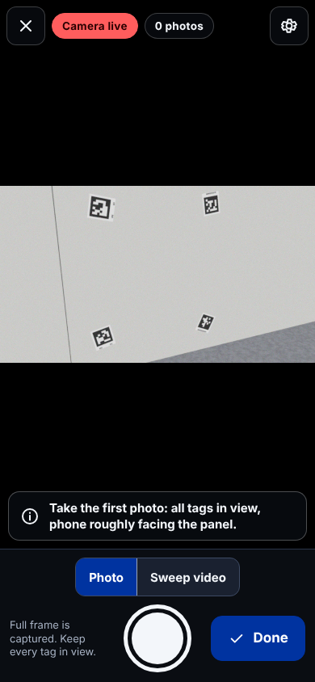

### 4. Datums

LUMEN proposes the floor line and the side line and shows how sure it is.
Zoom in and check that each line lies on the feature the record names. If a
line is wrong, choose its drawing tool and drag along the correct edge; with
"snap" on, the line is fitted to the edge under it. Press **Confirm datums**.

If two similar edges are close together LUMEN asks instead of choosing. It
also asks ("Is this the right line?") when a raised or recessed edge runs
along the line it found, as at the top of a kick strip: the line may then be
the edge of that part and not the feature the record means. Tap **Choose
detected line** and select the right one yourself; until then the result
stays a preview.

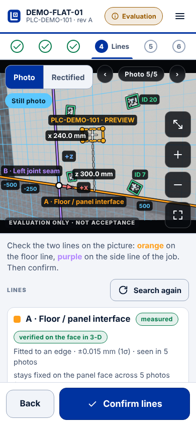 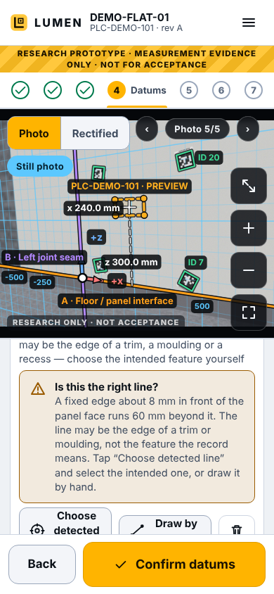

A seam or joint is measured at its centre line, in small photos and in
full-resolution ones where both of its edges can be seen; the datum card then
says how wide the seam is.

Each datum shows what is known about it lying on the panel face:
"verified on the face in 3-D" (the photos show it), "declared on the face
(not verified)" (the record says so and these photos cannot tell, which is
normal for a floor line photographed from one height), or "NOT on the face"
(the photos show it is not; it cannot be used).

For a rounded side edge the screen also shows the fitted radius. The card
"Flashlight experiment" is research only: it compares a second, experimental
estimate with the first and never changes a datum.

### 5. Rectified

The panel face as seen straight on, with a millimetre grid from the datums.
Things that are not on the face (floor, trim, the curved edge) look displaced
here; that is expected.

**Independent scale check (recommended):** every length LUMEN reports comes
from the tag sizes you entered. If all of them are wrong in the same way, no
photo can show it. Press *Show the two corners*, measure that distance on the
panel with a steel rule, type it in and press **Check**. If it contradicts the
tags, no target is drawn until the sizes are corrected.

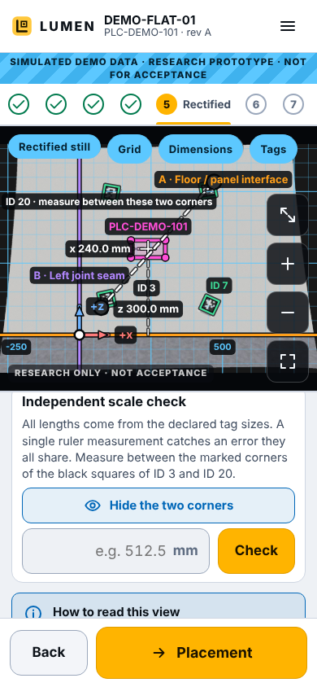

### 6. Place

First a photo with the outline of the placard and its distances from the
datums. The coloured banner says what you are looking at:

| Banner | Meaning | What to do |
|---|---|---|
| No guidance | something required is missing or contradictory; no outline | read the reason and the suggestion under it |
| Research preview | an outline, dashed; at least one check is not met | open the list of checks; usually: measure the tags, add a lens profile, take more photos, move closer |
| Prototype guidance | every check passed | use it as guidance within this study |

The stated uncertainty (± mm) is a property of this capture. It is compared
with the tolerance in the record; LUMEN never supplies a tolerance of its own.

The list of checks shows what stands behind the banner. A tick passed, a
warning or stop sign did not, and an "i" passed but tells you what was not
checked (for instance: no rule measurement was made, so the scale rests on
the tag sizes you entered).

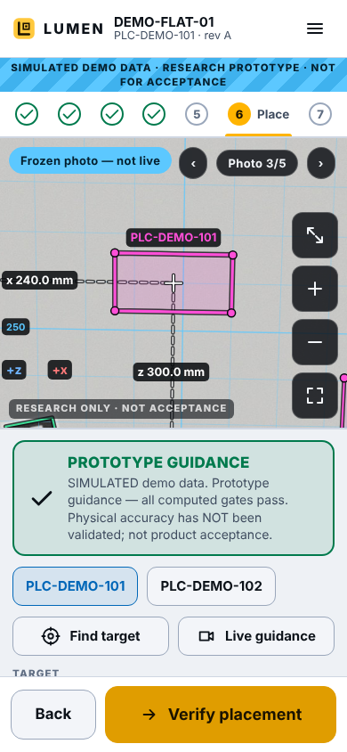 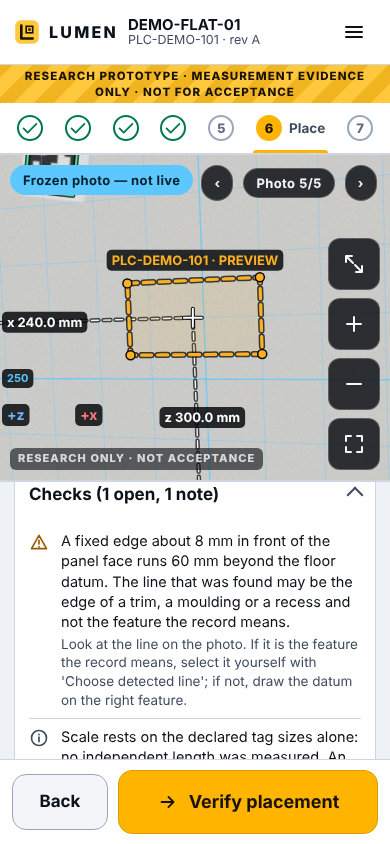

#### Live placement

This is how the placard is put on. The camera watches while you position it,
and the placement is measured while it happens, not afterwards.

1. Stand the phone where it sees the tags and the place of the placard: a
   stand, a clamp, a second person. Both of your hands should be free, and the
   phone should look at the panel as squarely as it can.
2. Press **Start live placement** and allow the camera. Turn the sound up.
3. Bring the placard to the dashed outline.

What you get, several times per second (ten or more while the phone stands
still; the panel then shows "phone steady"):

* **On the picture**: the placard as it was just measured, and an arrow to
  where it belongs.
* **On the dial**: the ring is the tolerance of the record. The disc is the
  placard, drawn as large as the uncertainty of this view. The placard is in
  position when the whole disc is inside the ring. The bar under the dial is a
  level for the rotation: the bubble belongs between the two marks.
* **In numbers**: how far to move it (the arrow shows the direction as on the
  screen) and how far to turn it.
* **By ear**: beeps that come faster as the placard nears its place, a steady
  tone while it is in position, a short falling pair when it leaves again. You
  do not have to look at the phone.
* **Green**: the screen flashes green and the picture gets a green frame when
  the placard is in position.

Press the placard on and take your hands away. As soon as nothing has covered
it for about a second, LUMEN takes a full-size photo by itself, measures it
as in the Verify step, and announces the result with a rising chime. The
camera stops and the step shows what was recorded.

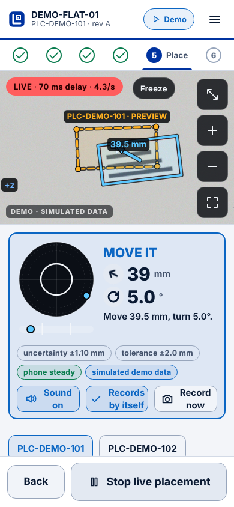 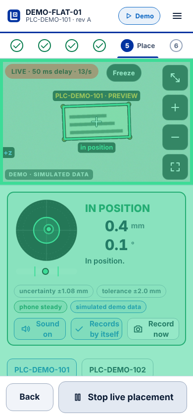 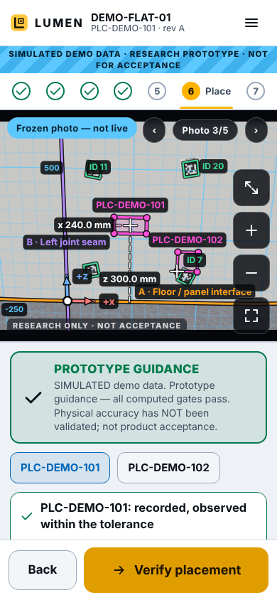

Things it says on the way:

| It says | Meaning |
|---|---|
| Bring the placard | no placard is seen near the outline |
| Move it | direction and distance are on the screen |
| Almost | too close to the limit to call: the disc touches the ring |
| In position. Let go to record. | in position, but a hand still covers part of it |
| Not flat on the surface | the placard measures larger than the record says, so it is still held off the panel. A placard held off the surface looks displaced; nothing is judged until it lies flat |
| The … sides are both covered | two opposite sides are under your hands: nothing shows where the placard is along them. Uncover one |
| The … side is not where a placard of the recorded size has it | three sides were found and the fourth is somewhere else, with nothing over it: check that it is the right part |
| Reading too coarse here | the uncertainty of this view is larger than the tolerance; the advice under it says what limits it |
| "It counts as in position only within ± … mm" | the uncertainty takes most of the tolerance. Without a lens profile for the photos of step 3 this is the usual case for a ±2 mm tolerance |

Your hands may cover part of the placard while you position it. A side that
is partly covered is still measured. A side that is covered completely is
placed from the opposite side and the placard's size in the record; it is
drawn dashed, and the uncertainty is larger while that is so. The record is
only ever taken from a picture in which all four sides are measured.

The three switches under the dial: **Sound** on or off; **Records by itself**
or **Record by hand**; **Record now** takes the record at once and stores what
it finds, whatever that is.

Each picture is analysed on the server and shown together with its result a
fraction of a second after it was taken. Move slowly over the last
millimetres and let the reading settle before you press the placard on.

Leave the phone alone once it stands. While it does not move, the tags are
measured once and then only checked in every picture, which is several times
faster, and your arm may pass over some of the tags without anything
changing. If the phone or the panel is moved, the tags are measured again by
themselves; the readings come more slowly for a moment. On an
iPhone the sound depends on the media volume, and on some settings on the
ring switch; if you hear nothing, switch **Sound** off and on once and check
the volume.

Several placards on the same panel: after a record, **Next: …** selects the
next one. The photos and datums stay valid.

### 7. Verify

The record of a live placement is already here: the stored photo with the
target outline, the measured outline and the numbers.

A placard that was installed without live placement, or one you want to check
again, is measured from one more photo (same tags, not moved). LUMEN finds
the placard's outline and reports how far it is from the target, in
millimetres along x and z and in degrees, with an uncertainty:

* **within**: inside the tolerance even allowing for the uncertainty;
* **outside**: outside it even allowing for the uncertainty;
* **indeterminate**: too close to call, or the outline had a problem (hidden
  corner, glare, curled edge). Take a better photo.

Check the drawn outline against the picture, then press **Confirm measured
outline** and **Export summary**. The summary is a JSON file with the
measurements, the checks and the software version. Photos are not in it.

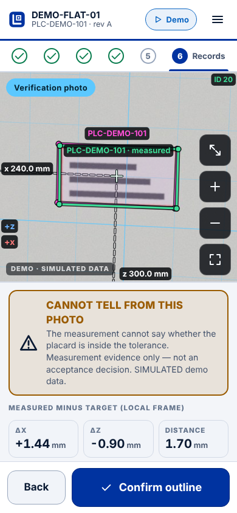

## Lens profile (once per phone)

Menu → **Settings & camera calibration**. Download the board, print it,
mount it flat, measure its squares, and take 10 to 15 photos of it as the
screen describes. Save the profile; it stays on this phone. Attach it to a
session from the same screen. Without a profile results stay at "research
preview", and in live placement the uncertainty takes most of a tight
tolerance. The profile that matters is the one for the photos of step 3: the
datums are measured in them, out to the edges of the picture. The live
picture itself needs none.

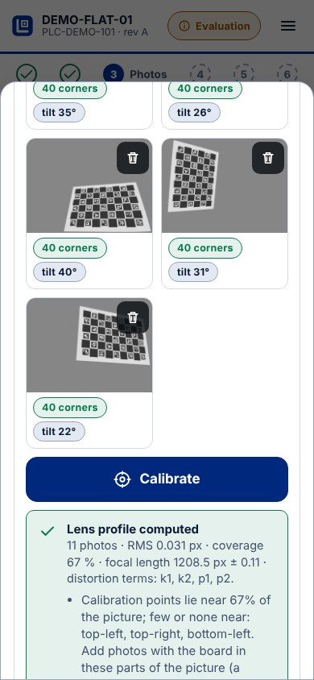

Use the same camera (lens), zoom and orientation for the board photos and for
the panel photos. A profile is not applied to photos that report another
camera, zoom or size.

## When you are done

Menu → **End session and delete photos**. Sessions are also deleted
automatically some hours after their last use.

## What LUMEN does not do

* It does not decide whether a part is acceptable.
* It does not know which way is down: directions come from the two datums in
  the record.
* It does not measure on curved surfaces. A rounded edge can serve as a datum;
  the placard itself must be on the flat face.
* It does not invent a missing datum, offset or tolerance.
* It cannot notice that every tag size was entered wrong in the same way
  unless you make the scale check.
